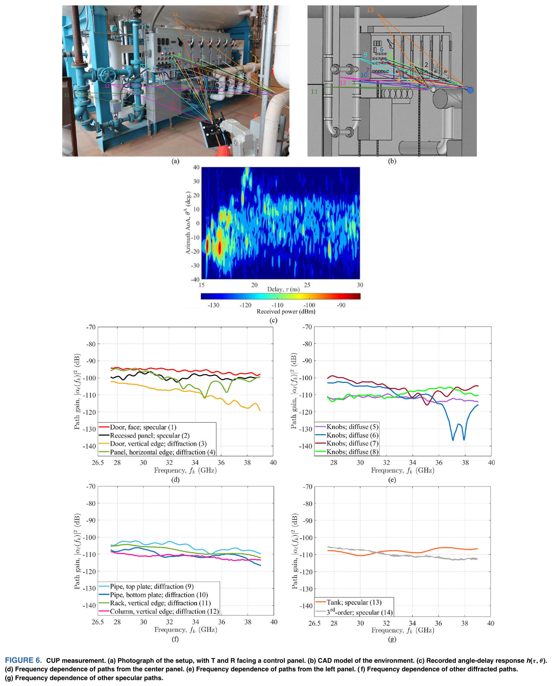
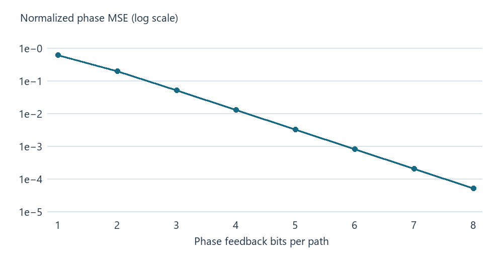
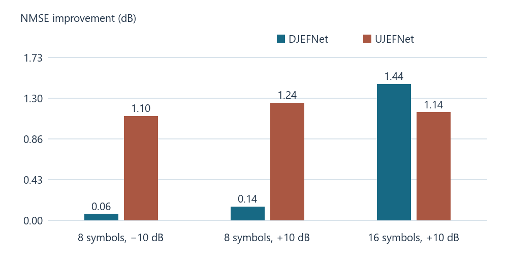
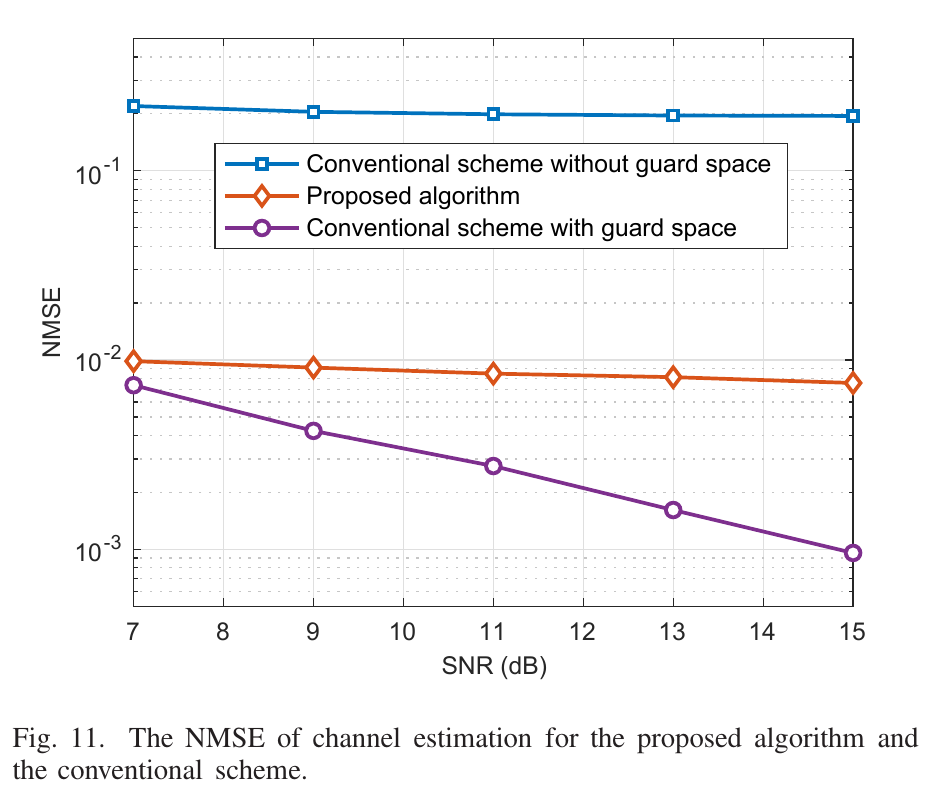
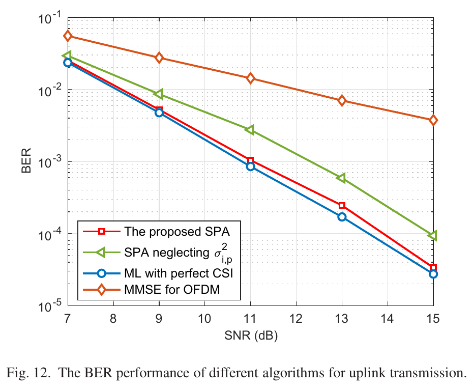
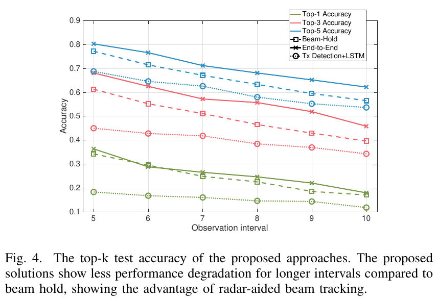
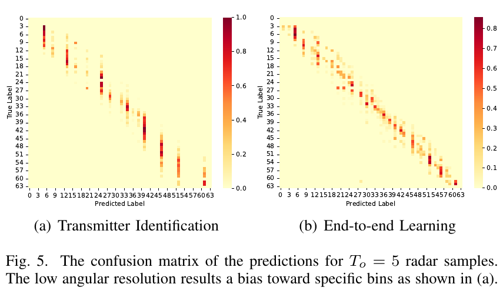
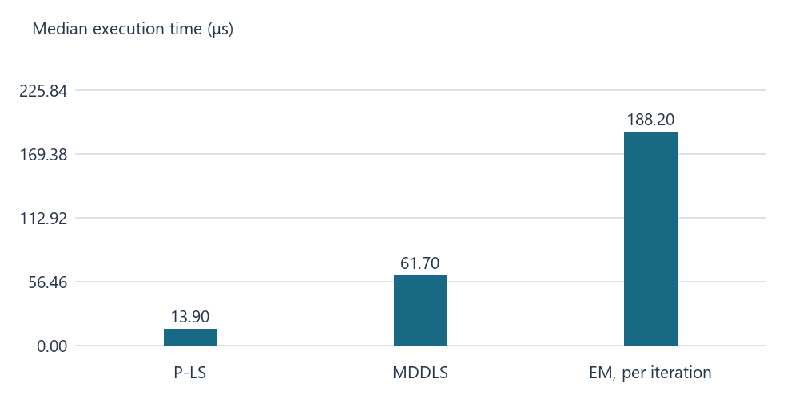

# 广义信道探测与 CSI 融合：观测、可辨识性与闭环设计

日期：2026-11-10 · 论文调研扩展版

这里的 sounding 指**用已知或受控信号探查传播通道**。它可以是蜂窝 SRS/CSI-RS、专用测量仪的扫频与宽带探测、波束扫描、通感系统的雷达波形，也可以是 Wi‑Fi 探测帧。CSI 是由观测推断的状态，形态可以是复数信道矩阵、压缩码字、预编码子空间、波束功率或带不确定度的路径参数。本文讨论的是**探测提供的一路观测，如何和另一时刻、链路、设备或处理链形成的 CSI 一起服务于目标**。

所调研文献显示，探测可提供候选路径或波束，通信观测可用于估计复系数或验证候选。按不确定度追加探测是基于这些结果提出的待验证方案。TDD 空间补全、FDD 相位反馈、雷达辅助波束和数据辅助跟踪，都可用这一框架理解，但它们估计的是不同对象。在所引 V2V 道路实测中，直接由低分辨率雷达角度选束的准确率低于维持上一束的基线。该结果支持进一步评估保留候选方向和置信度的方案。

## 1. 先定义两路输入与输出

设目标为链路 $\ell_*$ 在使用时刻 $t_*$ 的 $H_{\ell_*}(k,t_*)\in\mathbb C^{N_r\times N_t}$，其中 $k$ 为子载波。已知探测波形或波束 $X_s$，原始接收数据为 $Y_s$；现有 CSI 分支 $C$ 可由另一组导频、码本反馈或历史估计产生。对同链路阵列测量，$Y_s=W_s^{\mathrm H}H_sX_s+N_s$，其中 $W_s$ 是接收合并矩阵。对雷达，$Y_s$ 对应目标往返或双基地传播，需另写观测算子。带宽、频点、波束、端口、时间戳和校准信息都属于输入。基站 SRS、CSI-RS 和报告量的实例见 [ETSI TS 38.214，§5.2、§6.2](https://www.etsi.org/deliver/etsi_ts/138200_138299/138214/19.01.00_60/ts_138214v190100p.pdf)。

| 场景 | 探测分支 | 已有 CSI 或第二观测 | 合理输出 |
|---|---|---|---|
| 同频、异端口 | 单端口或部分端口探测 | 另一方向的低维 CSI / PMI | 缺失端口的可用空间子空间，条件好时重建复信道 |
| 异频、异时 | 跨频或较早时刻的信道测量 | 目标频段的少量相位、码字或短导频 | 当前复信道、预编码矩阵或未来时刻的 CSI |
| 雷达与通信 | 角度、距离、速度、目标轨迹 | 当前或历史导频、波束功率、波束索引 | 候选波束、路径支撑或链路预测 |
| 离线测量与在线 CSI | 专用声测仪扫出的路径簇、宽带角延迟图 | 部署设备当前的少量导频或短 CSI 序列 | 场景先验与实时修正后的 CSI |
| 探测与业务数据 | 导频初始化和标定 | 数据符号的软判决、解码后重构或历史 CSI | 同一链路连续跟踪 |
| 无线感知 | 监听设备从探测包估计的双基地 CSI | 客户端上报的波束反馈或另一链路 CSI | 共享散射体或目标的位置、轨迹 |

专用信道探测仪是这里的一个数据来源。Guven 等的 NIST 团队用 VNA 和机械臂合成虚拟阵列，在 26.5–40 GHz 对同一环境扫频。先去嵌仪器、线缆和天线影响，再以宽带 SAGE 抽取各路径的角度、时延和频变增益，并将候选路径与实景 CAD 中的入射物体配对。控制实验验证几何估计，真实环境结果见图 6–8。作者在固定有效孔径的比较口径下验证了自由空间 LoS 的频率不变性，同时观察到镜面反射路径的频率变化比某些衍射和漫散射路径更强。该测量直接提示：跨频融合时，可优先把角度与时延当作待验证的候选先验，再用工作频段的少量 CSI 校正各条路径的幅度。文献本身测量跨频特性，在线校正是本文基于结果提出的应用。见 [Guven 等，IEEE OJAP 2022，§II–IV](https://tsapps.nist.gov/publication/get_pdf.cfm?pub_id=934469)。

<figure class="paper-figure"><figcaption>Guven 等，IEEE OJAP 2022，<a href="https://tsapps.nist.gov/publication/get_pdf.cfm?pub_id=934469#page=9">图 6，印刷页 469</a>，<a href="https://creativecommons.org/licenses/by/4.0/">CC BY 4.0</a>。保留原图及图注，裁除周边正文。各路径的频率响应曲线形状不同，角度、时延可配对时也需要重新估计目标频段增益。</figcaption></figure>

## 2. 统一观测模型、可辨识性与新增信息

把传播状态写成 $x_t=\{\theta_p,\phi_p,\tau_p,\nu_p,\alpha_p,\delta_p\}_{p=1}^L$，分别表示收发角、时延（秒）、多普勒（Hz）、链路专属复增益和路径存在状态。对一条链路的局部宽带模型可写为

$$H_\ell(k,t)=\sum_{p=1}^L\delta_{\ell,p}\alpha_{\ell,p}a_{r,\ell}(\theta_p)a_{t,\ell}^{\mathrm H}(\phi_p)e^{-j2\pi f_k\tau_{\ell,p}}e^{j2\pi\nu_{\ell,p}(t-t_0)}.$$

不同频段和雷达拓扑可以共享散射体几何，但时延、多普勒、复增益和可见性可能不同。例如单站雷达测往返距离，通信链路测单程或经散射体的双段路径，两者需通过几何方程建立对应。一个纯传播例子是 $\Delta f=200\,\mathrm{MHz}$、$\tau=101\,\mathrm{ns}$ 时，两频点相位相差 $-72^\circ$（模 $360^\circ$），另有反射系数和硬件相位变化。直接跨频拷贝复数 CSI 需要比“同一条路径”更强的假设。

**约束一是可辨识性。** 对已对齐的简化线性模型 $y_s=A_s h+n_s$、$y_c=A_c h+n_c$，两路共同的盲区是 $\ker A_s\cap\ker A_c$。如果下行只报右奇异子空间，通常无法由此恢复接收侧奇异向量、所有增益或相位。给出一个全尺寸矩阵是算法输出，能否恢复真实矩阵取决于观测秩和先验。若只需要选波束，某些矩阵歧义不会改变最优动作。

**约束二是新增信息。** 令 $C$ 为基线已可用 CSI。如果基线已拥有 $Y_s$，将由同一 $Y_s$ 确定性算出的码字重复加入无法增加信息。本文用 $I(H_*;Y_s\mid C,\mathcal M)$ 表达新增信息，其中 $\mathcal M$ 为测量元数据。几何匹配、时间对齐和源间相关误差决定这部分信息是否能被正确提取。

在线融合可写成先验预测再修正。在已对齐、独立高斯误差和线性 CSI 观测 $z=Ah+e$ 下，从 sounding 得到先验均值 $\mu_s$ 与误差协方差 $R_s$ 后，有

$$\widehat h=\mu_s+R_s A^{\mathrm H}(A R_s A^{\mathrm H}+R_c)^{-1}(z-A\mu_s).$$

这条公式是本文统一基线。它表达了“只在可观测方向上修正”。如果输入是 PMI，应建码字似然或使用子空间约束。若误差相关，应堆叠观测并使用含非零交叉项的联合噪声协方差。若多个目标可能对应同一回波，还需在更新前或更新中显式处理数据关联。

## 3. Lee 等：TDD 不对称端口下的空间重建

Hyeongtaek Lee 等来自 KAIST 与三星电子网络业务部门。论文要解决的是 UE 有多个接收端口却只能从少量端口发上行探测时，如何让基站取得可用于空间复用的下行信道。仿真中基站 32 根天线、4 个 CSI-RS 端口、UE 4 根接收天线，考虑 2 或 4 层反馈。研究路线是先利用上行观测确定可利用的出射方向，再利用下行反馈约束接收侧和多层结构。见 [原文 §II–IV](https://arxiv.org/html/2102.05224v1)。

1. 基站用一组低维波束 $P\in\mathbb C^{N_t\times K}$ 发送 CSI-RS。UE 得到 $Z=H_dP+N$，随后在码本中选 $K\times L$ 的 PMI 矩阵 $V$。论文式 (7) 最大化由 $V^{\mathrm H}Z^{\mathrm H}ZV$ 导出的频谱效率。基站拿到的是索引和可重构码字。
论文式 (7) 按本文符号改写如下。$\rho_{\mathrm{DL}}$ 为下行信噪比，$\mathcal C$ 为 PMI 码本，$L$ 为传输层数。代价函数评价每个候选码字在所观测低维信道上的空间复用速率。

   $$V_*=\arg\max_{V\in\mathcal C}\log_2\det\left(I_L+\frac{\rho_{\mathrm{DL}}}{L}V^{\mathrm H}Z^{\mathrm H}ZV\right).$$

2. 从 SRS 向量搜索基站端主出射方向，形成字典 $A_b$；从反馈构造的有效信道代理搜索接收侧方向，形成 $A_r$。将代理记为 $\widetilde Z$。按下行矩阵约定，论文式 (37)–(40) 的计算可概括为

$$\widehat C=A_r^\dagger\widetilde Z(A_b^{\mathrm H}P)^\dagger,\qquad \widehat H=A_r\widehat C A_b^{\mathrm H}.$$

3. 论文随后用 SRS 已观测的端口分量替换对应的重建分量。论文还有凸优化式预搜索，以及按方向关系进行的其他重建基线。伪逆把迭代优化换成阵列搜索和矩阵运算，适合做可解释基线。如果 $A_b^{\mathrm H}P$ 的小奇异值很小，即使形式上存在伪逆，噪声和码字量化误差也会被放大。工程对照可以加入截断 SVD，观察频谱效率与条件数的关系。

**读图。** 图 9 为动态选 CSI-RS 波束、UPA、2 层场景，横轴上行 SNR、纵轴平均频谱效率。预搜索与伪逆可以超过作者定义的 Type 2 对照。这里的 Type 2 是该论文的无量化有效信道对照。它仍然只使用低维下行信道，这一对照表明，在所用仿真设置下，SRS 提供了有助于空间重建的额外约束。原文图 10–11 再换 UMa 或扫下行 SNR，所用仍是 SCM 仿真。这些仿真结果支持在所考察的配置下利用上行观测缩减下行训练维度。实测验证仍需覆盖多端口切换时延、射频校准误差和波束投影条件数。见 [图 9–11 与实验设置](https://arxiv.org/html/2102.05224v1#S4)。

| Lee 等对照 | 基站取得的信息 | 图 9 的报告结果 |
|---|---|---|
| Type 2 | 无量化的低维有效下行信道 | 用作下行单源对照 |
| 预搜索或伪逆 | 低维下行观测及上行 SRS | 在该设置下可超过 Type 2 的平均频谱效率 |

该对照采用 32 根基站天线、4 根 UE 接收天线、2 层反馈、动态选 CSI-RS 波束及 UPA。结论为 [Lee 等 §IV 对图 9 的描述](https://arxiv.org/html/2102.05224v1#S4)。原曲线未确认可转载许可，表中采用作者明确报告的比较关系。

## 4. Kim 等与 JADD：在目标频率补相位，在目标时刻补演进

Jungyeon Kim 等的署名机构包括 POSTECH、KAIST、延世大学、ASU 和高丽大学。论文从近似共享的路径角度与幅度出发，把反馈负载集中到下行相位。对某条已配对路径，基站由上行测量得到 $\theta_p$ 和 $\beta_p$，UE 由下行导频估计该路径相位并量化为中心 $q_p$。用 $B_p$ 个比特时，均匀量化区间半宽为 $d_p=\pi/2^{B_p}$。若给定量化区间内的误差均匀分布，条件均值为 $\mathbb E[e^{j\epsilon_p}]=\sin d_p/d_p$。于是式 (13)–(14) 可写成

$$\widehat h_d=\sum_p\beta_p\frac{\sin d_p}{d_p}e^{jq_p}a_d(\theta_p).$$

这里 $a_d$ 必须按下行波长构造。论文接着以总比特约束 $\sum_p B_p\le B_{\rm tot}$ 最小化误差，按该误差模型，同等量化精度下较强路径的误差权重更高。按高分辨率近似，单路失真随 $\beta_p^2 2^{-2B_p}$ 缩小，适合解释比特分配，原文求解使用实际误差函数。随后基站把相位量化引起的误差协方差交给稳健预编码。图 8 在 10/12 GHz、16 用户、每用户 3 路径的仿真中显示约 20 bit/用户接近完美 CSIT 的 WMMSE 参考。图 9 用空间平滑 MUSIC 估计几何，图 10 扫路径数。复现时应记录路径配对方式和目标频段导频设置。20 bit 指反馈负载，整体空口预算还包括导频与控制资源。见 [Kim 等，式 (13)–(14)、§IV–VI](https://arxiv.org/html/2405.08614v1)。

下图按 Kim 等式 (14) 计算单路径的量化影响。令 $d=\pi/2^B$，相对于路径功率的条件均方误差为 $1-(\sin d/d)^2$。它只描述均匀相位误差模型，不包含几何估计误差或系统级频谱效率。

<figure class="paper-figure"><figcaption>按 <a href="https://arxiv.org/html/2405.08614v1#S3.SS1">Kim 等式 (13)–(14)</a> 计算的理论图。比特增加后相位量化误差迅速下降。</figcaption></figure>

**JADD 把这个问题再向时间推一步。** Ziao Qin、Haifan Yin、Yandi Cao、Weidong Li、David Gesbert 的方案先从一串上行样本构造角度、时延和时间基。Matrix Pencil 用移位后的数据结构估计复指数极点，极点相角对应采样间隔内的相位旋转。基站再把上行可迁移的几何及多普勒关系转换到下行，构造宽带探测波束，让 UE 在小维度表示中估计下行复系数。基站收到反馈后，按原文式 (53) 将各模式推进到使用时刻。简化写法为

$$\widehat h_d(t+T_d)=\sum_{j,m}\widehat a_{j,m}e^{j2\pi\widehat\nu_{j,m}(t+T_d)}d_j.$$

其中 $d_j$ 是角延迟基，$T_d$ 是 CSI 延迟。多普勒误差 $\Delta\nu$ 在额外 $T_d$ 秒上导致相位误差 $2\pi\Delta\nu T_d$。例如 20 Hz 的误差持续 10 ms 就产生约 $72^\circ$ 的相位偏差，此为本文计算。提高模型阶数可以解释更多模式，也可能拟合噪声，因此要一起扫外推跨度和模式数。原文表 I 为 CDL-A、1.92/2.11 GHz、20 MHz。图 3 以 5 ms 延迟和无噪声样本比较 60/350 km/h；图 4 进一步考虑反馈量化并扫时延。频谱效率与预测误差分别读。仿真中的车速需与延迟、信道模型及观测质量一起解读。场景突变和路径生灭对预测误差及重初始化频率的影响有待验证。见 [Qin 等，IEEE TWC 2022，式 (53)、图 3–4](https://arxiv.org/pdf/2202.05564#page=9)。

JADD 的时间预测可通过下列单分量例子理解。采样间隔为 $T_s$ 时，序列 $u[n]=a z^n$ 满足 $u[n+1]=z u[n]$，其中 $z=e^{j2\pi\nu T_s}$，故 $\nu=\arg(z)/(2\pi T_s)$ 需要结合无混叠频率范围解读。多分量时使用移位的 Hankel 矩阵求多个极点。下面列出原文的两个比较设置。

| 对照 | 仿真条件 | 指标和比较 |
|---|---|---|
| 图 3 | 延迟 5 ms，无噪声上行信道样本，60 / 350 km/h | 比较频谱效率。JADD 在两种速度下均优于文中的 Enhanced Type II、APF-RNS 和 TVAL3 |
| 图 4 | 扫 CSI 延迟，量化反馈，幅度 4 bit、相位 6 bit | 比较预测误差，可观察量化条件下误差如何随延迟变化 |

表格依据 [Qin 等图 3–4 及 §VI](https://arxiv.org/pdf/2202.05564#page=9)。原曲线未确认可转载许可。上式为解释 Matrix Pencil 移位关系的单分量推导。

## 5. UJEFNet 与 Merge for Reconstruction：学习式融合的证据与缺口

Yiran Guo、Wei Chen、Bo Ai 的 UJEFNet 由北京交通大学团队提出。它把下行导频选择、反馈与基站重建放到同一个目标下。基站送下行导频，UE 直接编码接收到的导频矩阵为 $K$ 个复反馈符号；反馈链路损伤进入训练。基站先解码得到粗下行角频域 CSI，再把由稀疏上行导频得到的估计作角域 DFT，作为侧信息反复拼接到 Refine Blocks。上行估计可用 LS 插值或学习式重建。论文式 (16)–(20) 分开定义上行 CE、融合与损失。本文把其最终目标重写为

$$\min_{\Theta}\;\mathbb E\left[\|\mathcal D_{\Theta}(\widehat s,\widehat G_u)-G_d\|_F^2\right].$$

$\widehat s$ 是通过有噪反馈链路到达基站的符号，$\widehat G_u$ 是有估计误差的上行角频域 CSI。先生成有噪输入再训练，能够让网络见到推理时会发生的估计误差。作者分别控制上行导频间隔、反馈 SNR 和下行导频数。CDL-C/Sionna 仿真采用 5.6/5.4 GHz、32×1 天线、256 子载波，训练/验证/测试是 100k/30k/10k 对。见 [UJEFNet §III–IV](https://arxiv.org/html/2504.10836v1)。

| 图 9 条件 | 相对 JEFNet，单纯加深 DJEFNet | 相对 JEFNet，加入上行 CSI 的 UJEFNet |
|---|---:|---:|
| 8 个复反馈符号，反馈 SNR −10 dB | 0.06 dB | 1.10 dB |
| 8 个复反馈符号，反馈 SNR +10 dB | 0.14 dB | 1.24 dB |
| 16 个复反馈符号，反馈 SNR +10 dB | 1.44 dB | 约 1.14 dB |

表中是 NMSE 改善，使用 16 个下行导频，下行估计 SNR 10 dB。第三行显示相对收益随反馈配置变化。同深度对照控制了深度差异。进一步复现可匹配参数量与处理时延，并将随机错配的上行 CSI 作为负对照，以区分侧信息收益与模型容量的影响。数字符号反馈与模拟 DJSCC 应按信道使用次数、功率和解码延迟对齐预算。见 [原文图 6–11](https://arxiv.org/html/2504.10836v1#S4)。

<figure class="paper-figure"><figcaption>根据 <a href="https://arxiv.org/html/2504.10836v1#S4.SS4">UJEFNet §IV-D 对图 9 报告的数值</a> 绘制，16 个下行导频、估计 SNR 10 dB。最后一组 UJEFNet 的 1.14 dB 为原文近似值。</figcaption></figure>

**Merge for Reconstruction** 由 Yisheng Zhang、Jingbo Tan、Xu-Dong Zhang、Jintao Wang 和 Yifeng Zhang 署名，涉及清华大学电子工程系与中兴通讯，发表在 2026 年 IEEE Transactions on Broadcasting。公开摘要可确认基站端使用 U-Net 合并 SRS 和 CSI 反馈重建出的不完美信道，上下采样使用残差与自注意力。时变分支有时间步嵌入，静态场景还给出基于 VQ-VAE 潜空间的轻量版本。全文仍未取得，因此无法核对训练损失、两分支时间戳定义、导频与反馈预算和实验幅度。这个架构提出了一个明确可检验的假设：当两路年龄不同，显式编码时间能比按同一时刻拼接取得更稳定的结果。检验需要同容量无时间输入对照，还应单独测 SRS 弱覆盖、反馈变旧和两路同时失效。见 [论文 DOI](https://doi.org/10.1109/TBC.2026.3670696) 与 [公开作者摘要](https://www.researchgate.net/publication/401909398_Merge_for_Reconstruction_Deep_Learning-Based_Channel_Merging_Based_on_SRS_and_CSI_Feedback_in_Massive_MIMO_Systems)。

**同类方法的演进。** DualNet 把上行幅度放在解码器侧，CAnet 把上行角域幅度同时用于自适应导频设计和反馈解码。CAnet 表 IV 中，24 bit、6 个下行导频时，独立估计再反馈与直接编码导频观测的 NMSE 分别为 −4.59 和 −7.11 dB。16 bit、8 个导频时两者排序反转。Dual-ImRUNet 则把目标收窄为预编码特征向量，采用跨频补偿与样本对齐。其图 5 在 30 个未见地图的射线追踪测试中报告 6 bit、SGCS 0.85。后者衡量方向相似度，和全复矩阵 NMSE 属于不同任务。见 [DualNet 原文](https://par.nsf.gov/servlets/purl/10149759)、[CAnet 表 IV](https://arxiv.org/html/2101.04377v1#S6) 和 [Dual-ImRUNet 图 5](https://arxiv.org/html/2507.12301v1#S4)。

## 6. Yuan 等：从雷达回波取得稀疏支撑，再用导频估增益

Weijie Yuan、Zhiqiang Wei、Shuangyang Li、Jinhong Yuan、Derrick Wing Kwan Ng 的 UNSW 团队将 OTFS 通信波形同时用于路侧单元的雷达探测。下行回波估计车辆角度、时延和多普勒，再通过车辆运动状态预测下一时刻的几何。下行利用预测方向形成波束并预均衡。上行的关键做法是先从感知预测延迟–多普勒支撑，再用通信导频估计随机的复增益。

在传统 OTFS 中，单导频周围设置保护区，避免未知业务符号卷入导频观测。该文用预测路径坐标 $\bar k_p,\bar l_p$ 找到已知导频经第 $p$ 条路径后的接收格点。以下按 arXiv HTML 版式 (45)–(47) 改写。

$$y[k_0+\bar k_p,l_0+\bar l_p]=h_p x_{\rm pl}+I_p,\qquad \widehat h_p=\frac{y[k_0+\bar k_p,l_0+\bar l_p]}{x_{\rm pl}}.$$

其中 $I_p$ 含数据引起的干扰与噪声，$\widehat h_p$ 的误差方差随 $\mathbb E[|I_p|^2]/|x_{\rm pl}|^2$ 变化。作者把估计方差继续传给因子图上的 sum-product 检测器，式 (62) 在消息方差里显式处理 CSI 不确定性。这是论文里第二次融合：第一步将感知给出的路径支撑与通信导频合起来，第二步把信道估计误差传给数据检测器。

式 (62) 的消息方差可用 $v_{p'}$ 记其他路径符号的输入消息方差，省略车辆和网格下标后写成

$$v_{y\to x_p}=\frac{N_0+\sum_{p'\ne p}E_s\left[\sigma_p^2+\left(|\kappa_{p'}\widehat h_{p'}|^2+\sigma_p^2\right)v_{p'}\right]}{|\kappa_p\widehat h_p|^2}.$$

$N_0$ 为噪声项，$E_s$ 为数据符号能量，$\kappa_p$ 为波束增益，$\sigma_p^2$ 为估计误差方差。保留了 arXiv HTML 式 (62) 中误差项的下标 $p$。作者用这一方差控制检测消息的置信度。

**结果与代价。** 论文仿真为 3 GHz、6 kHz 子载波间隔、四车、车速 10–15 m/s、BPSK、OTFS 128×30 网格。表 II 的保护格由 480/3840（12.5%）降到 0。仍需导频，且图 11 中导频功率高于数据 20 dB。无保护方案的信道 NMSE 约停在 $10^{-2}$，传统有保护基线的估计更准确。图 12 显示把不确定性纳入检测比忽略不确定性更好。在该仿真设置下，路径支撑先验降低了保护格开销。评估净收益还需计入探测、导频功率和模型失配的代价，并分别测试路径位置偏差、漏路径和新路径出现时的错误率。见 [Yuan 等，原文 §III-D、图 11–12 和表 II](https://arxiv.org/html/2105.03125v2#S4)。

<figure class="paper-figure"><figcaption>Yuan 等，arXiv:2105.03125v2，<a href="https://arxiv.org/pdf/2105.03125v2#page=11">图 11，第 11 页</a>，<a href="https://creativecommons.org/licenses/by/4.0/">CC BY 4.0</a>。保留原图及图注，裁除周边正文。感知先验将无保护区的估计误差压低，但带保护区的传统方案随 SNR 继续改善。</figcaption></figure>

<figure class="paper-figure"><figcaption>Yuan 等，arXiv:2105.03125v2，<a href="https://arxiv.org/pdf/2105.03125v2#page=12">图 12，第 12 页</a>，<a href="https://creativecommons.org/licenses/by/4.0/">CC BY 4.0</a>。保留原图及图注，裁除周边正文。红色方案比忽略估计误差的绿色方案更接近完美 CSI 参考，差距在较高 SNR 区域可见。</figcaption></figure>

## 7. Luo 等：实测中雷达适合缩小波束候选

Hao Luo、Umut Demirhan 和 Ahmed Alkhateeb（ASU）研究的是用**历史通信波束与雷达时间序列**预测未来波束。通信接收机在 60 GHz 对 64 个候选束测功率，最大功率对应标签。雷达为车载 FMCW，起始频率 77 GHz，使用四根接收天线。雷达经 FFT 获得距离、速度和角度相关特征，论文比较两条路线。

- **目标识别再映射。** 先提取候选雷达目标，结合历史通信波束识别发射车，再由估计方向选通信波束。角度估计的不确定性经过两次决策传递，在雷达角分辨率比波束间距粗时会造成系统性偏向。
- **直接预测波束。** 网络以雷达序列和已知初始束为输入，通过交叉熵预测候选束概率，见原文式 (11)。历史束给出射频链路当前的角度锚，雷达序列用于追踪相对变化。

Luo 等式 (11) 的交叉熵目标按本文符号写为

$$\mathcal L(\Theta)=-\frac1T\sum_{t=1}^T\log\left[g_\Theta(\mathcal H_t^{\rm RV},b^*_{t-T_o+1})\right]_{b_t^*}.$$

$\mathcal H_t^{\rm RV}$ 是雷达时间窗，$b^*_{t-T_o+1}$ 为起始通信波束，$b_t^*$ 是由通信扫束功率确定的目标标签。Top-$K$ 以标签是否出现在概率最高的 $K$ 个候选中计分。

**实测结果。** DeepSense 6G Scenario 38 是实际道路 V2V 测量，每秒 10 样本，保留波束变化窗口后有 3649 条序列，按不重叠时间区间切 70/30。图 4 以维持初始束及其邻居为基线，目标识别路线整体弱于基线；端到端路线的 Top-1 提升有限，作者报告 Top-3 约提高 6–9%、Top-5 约提高 3–6%。图 5 的混淆矩阵显示目标识别方法集中在部分方向格。候选集命中率的改善为“先筛选候选，再用短导频确认”提供了实验依据。采用该闭环后可节省的实际扫描资源仍待测量。原文结果来自一套道路场景且筛选了波束变化样本，系统上线前还需比较波束功率损失、实际扫描次数和跨路线泛化。见 [Luo 等，原文 §IV–VI，图 4–5](https://arxiv.org/html/2308.01558v2#S6)。

<figure class="paper-figure"><figcaption>Luo 等 arXiv:2308.01558v2 <a href="https://arxiv.org/pdf/2308.01558v2#page=5">图 4，第 5 页</a>。<a href="https://creativecommons.org/licenses/by/4.0/">CC BY 4.0</a>，由原 PDF 裁切，保留图例和原图注。各观测窗口长度的 Top-1、Top-3、Top-5 准确率。</figcaption></figure>

<figure class="paper-figure"><figcaption>Luo 等 arXiv:2308.01558v2 <a href="https://arxiv.org/pdf/2308.01558v2#page=5">图 5，第 5 页</a>。<a href="https://creativecommons.org/licenses/by/4.0/">CC BY 4.0</a>，由原 PDF 裁切，保留图例和原图注。目标识别后选束与端到端选束的混淆矩阵。</figcaption></figure>

## 8. 补充案例：卫星链路跟踪与 Wi‑Fi 异链路定位

**卫星链路用数据纠正导频老化。** Abdollah Masoud Darya 和 Saeed Abdallah 来自沙迦大学相关团队，研究多用户 LEO 上行残余多普勒。导频先给出 LS 初值，E 步根据当前信道给星座符号分配后验权重，M 步用软符号的加权统计更新复系数，然后投影到低阶离散 Legendre 基。可把更新理解为逐次使用“置信度不同的虚拟导频”。原文图 1 用 5 个 Zadoff–Chu 导频、50 个数据符号，默认 10 次迭代。在 SER 为 0.1 的点，相对结合相同基展开的 MDDLS 约节省 2.5 dB SNR，NMSE 的优势在 SNR 高于 −2 dB 时出现。表 II 的 MATLAB/Xeon 中位耗时为 EM 每次迭代 188.2 微秒，MDDLS 61.7 微秒。整帧处理的算法延迟、等待整帧的时延和错误传播风险都应另报。导频和业务数据在同频同链路上形成反馈环，导频稳定启动，后续数据更新时变 CSI。见 [原文 §III–IV](https://arxiv.org/html/2505.14118v3)。

按 Darya 与 Abdallah 式 (23) 改写。设 $w_{s,n}^{(i)}=\Pr(x_s=\xi_n\mid \widetilde y_s,\widehat h_s^{(i)})$，其中 $s$ 为数据符号时刻，$\xi_n$ 为星座点。对每个时刻做软权重更新，再将时间序列投影到正交 Legendre 基 $\Psi$ 的列空间。

$$q_s^{(i+1)}=\frac{\sum_n w_{s,n}^{(i)}\widetilde y_s\xi_n^*}{\sum_n w_{s,n}^{(i)}|\xi_n|^2},\qquad \widehat{\boldsymbol h}^{(i+1)}=\Psi\Psi^{\mathsf T}\boldsymbol q^{(i+1)}.$$

<figure class="paper-figure"><figcaption>根据 <a href="https://arxiv.org/html/2505.14118v3#S4">Darya 与 Abdallah 表 II</a> 绘制。188.2 μs 是单次迭代耗时。</figcaption></figure>

**Wi‑Fi：用客户端反馈约束旁路雷达的定位。** 《Hybrid Fusion for 802.11ax Wi-Fi-based Passive Radars》里的两路分别是旁路雷达从 AP 的 NDP 估计到的反射 CSI，以及客户端测得另一条链路并回报的 BFF。论文式 (14)–(17) 从旁路 CSI 得到样本协方差，从 BFF 的主右奇异方向与流增益近似客户端的协方差，依赖客户端直达路径占优。然后在候选目标间做关联，把雷达 AoD/AoA 和客户端 LoS AoD 的得分加起来，再交替细化目标位置。图 2 仿真设两个客户端目标和一个非客户端目标。融合改善客户端命中率和定位误差，非客户端目标因错误关联略有退化。命中定义为 2 米内，RMSE 仅统计所有方法都命中的样本，故两项指标应一起看。Wi‑Fi 在这里展示的是**异链路证据的关联**，其机制也适用于多站蜂窝或双基地探测。见 [原文 §IV–V](https://arxiv.org/html/2404.14269)。

Wi‑Fi 融合采用的两个协方差按原文式 (14)、(17) 简化为

$$\widehat R_{\rm rad}=\frac1N\sum_{k=1}^{N}h_{{\rm rad},k}h_{{\rm rad},k}^{\mathrm H},\qquad \widehat R_{{\rm cli},u}\approx\frac1N\sum_{k=1}^{N}\widehat\sigma_{u,k}^2\widehat v_{u,k}\widehat v_{u,k}^{\mathrm H}.$$

前式对旁路接收端向量化后的 CSI 作频域平均。后式用客户端 $u$ 的反馈恢复主右奇异向量 $\widehat v_{u,k}$ 和主奇异值 $\widehat\sigma_{u,k}$，保留主模态的功率与方向。在直达占优条件下，该方向可辅助定位客户端。对应结果按目标类型列在下表。

| 目标类型 | 与 NDP 单源对比 | 统计口径 |
|---|---|---|
| 客户端 | 联合关联法的命中率和定位 RMSE 改善 | 2 m 命中阈值，RMSE 在共同命中的目标上计算 |
| 非客户端 | 命中率和 RMSE 略有退化 | 作者将退化归因于错误关联 |

来源为 [Willame 等图 2 及 §V](https://arxiv.org/html/2404.14269#S5) 的作者文字结论。

## 9. 调研结论、研究趋势与验证计划

**结论一：任务决定融合输出及评价指标。** 定位可利用几何约束，波束管理可输出候选集，多用户零迫和相干联合传输对复系数精度和射频校准有更高要求。Lee 等评估的是下行重建后的频谱效率，Luo 等评估的是候选波束命中率。两者应按各自任务分别报告信道 NMSE、净频谱效率、波束功率损失或定位漏检率。

**结论二：观测时效与路径关联会影响融合收益。** JADD 的仿真显示显式时间模型可缓解 CSI 老化，OTFS 仿真显示已知路径支撑可减少保护格，Wi‑Fi 案例则显示错误关联可能降低非客户端目标的定位表现。可在相同资源预算下对比硬关联与软关联，并施加时间漂移、端口错配、遮挡及路径生灭，估计融合性能低于单源基线的条件。

**研究方向一：评估按不确定度触发的探测。** 保留一个稀疏的周期探测作为底线。当预编码风险、创新残差或候选束熵超过阈值，触发一次定向短扫或请求下行相位更新。可用验证集校准触发阈值，在相同空口预算下对比固定周期。评价指标包括尾部时延、波束失配概率和用户净速率的第 5 百分位，并需计入触发判断的计算开销。

**研究方向二：分开建模共享几何和链路专属残差。** 场景测量图或雷达可以提供慢变先验，短导频可用于估计当前链路的幅度、相位及新增路径。物理模型负责频率和阵列映射，轻量学习器预测误差协方差、补漏路径或给出候选。验证时留出整条路线、频段或设备，分别报告匹配路径和未匹配路径。跨站点数据还应记录共同反射体的可见性，避免把一个站的角度直接当成另一个站的角度。

**研究方向三：检验波束预测对端到端性能的影响。** Top-K 只有落实为少扫几个波束、少重传或更快完成链路建立才转化为系统收益。将有效净速率近似写为 $R_{\rm net}=(1-\rho_{\rm air})R_{\rm payload}$，其中 $\rho_{\rm air}$ 应包括探测、反馈和重扫的时间频率资源；另报计算时延和能耗。对不同类型的侧信息分开记录采集功耗与共享开销。以上方向由所调研文献的结果与局限推导，仍需同预算对照与跨场景验证。

| 验证阶段 | 要做的实验 | 可以推翻的假设 |
|---|---|---|
| 仿真机制验证 | 固定每帧探测资源、反馈资源和功率。比较探测单源、已有 CSI 单源、伪逆或 MMSE、同容量拼接和可靠性融合。加入打乱配对的控制组。 | 打乱后仍有相同增益，说明网络可能主要利用了统计先验或容量。 |
| 回放与实测 | 记录真实时间戳、同一地点的稠密探测参考、少量导频、历史 CSI 和波束功率。按路线、日期、设备留出。 | 随机切分效果好而整路线留出失败，说明跨场景收益待建立。 |
| 闭环测试 | 在相同空口预算下比较固定周期探测、按风险触发、Top-K 短扫及穷举参考；逐步扫缺失、遮挡和时延。 | 若新增探测或计算吞掉吞吐收益，表明应重新定义触发与输出任务。 |

复现可按任务选择对照。蜂窝同链路重建可采用上行探测和下行反馈的单源基线。非蜂窝场景中，ASU 道路数据适合检验波束跟踪，UNSW 的 OTFS 仿真适合分离路径几何误差、估计方差和导频开销。两类实验均可在固定资源预算下评估第二路观测对目标任务的增益。
