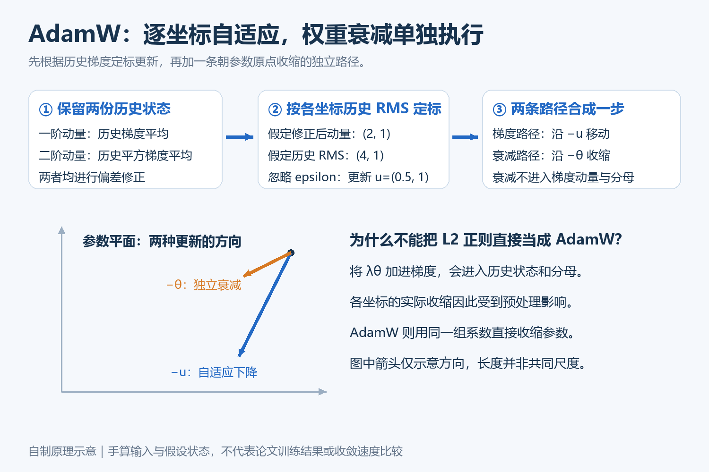
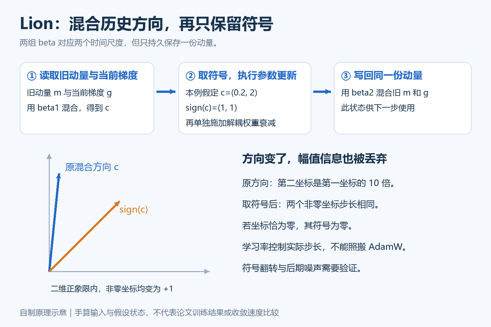
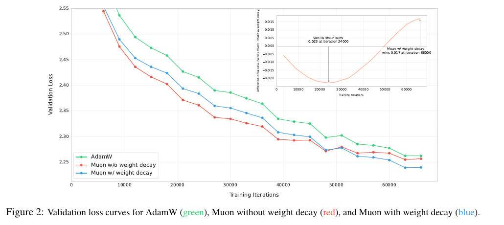
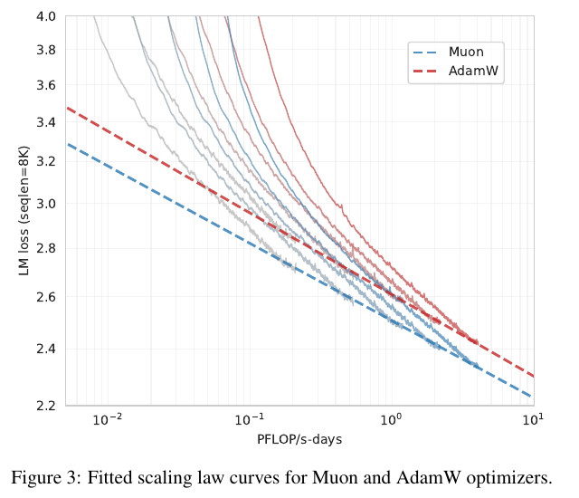
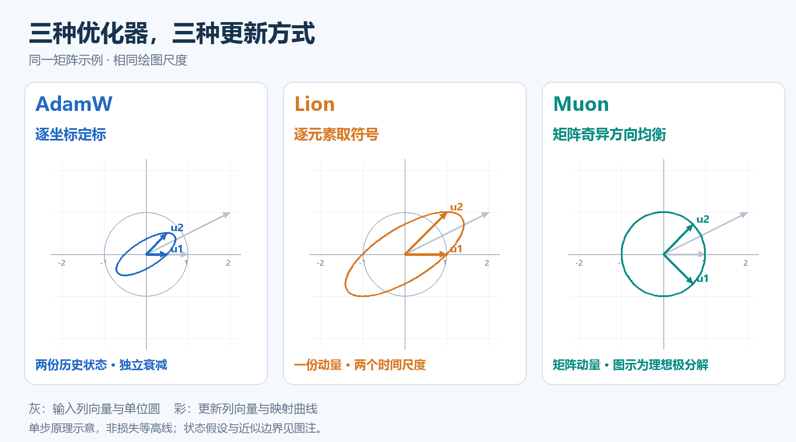

# 从 AdamW 换到 Lion 或 Muon，能省下什么？

日期：2026-11-24 · 中文文献调研 · 核心版本为 AdamW v3、Lion v4、Muon 扩展研究 v1

## 换个优化器，训练会有什么变化？

想省显存，还是想用更少算力达到同样的训练损失？这两个目标，对应的选型可能不同。

**AdamW** 按历史梯度调整各坐标的步长，并独立衰减权重。**Lion** 用符号决定更新方向，只存一份动量。**Muon** 按矩阵结构调整更新，在一些语言模型预训练实验中降低了计算量，微调时收益则不稳定。

## 1. 问题建模与共同的演变起点

训练目标为 $\min_\theta F(\theta)=\mathbb E_{z\sim\mathcal D}[\ell(\theta;z)]$。参数 $\theta\in\mathbb R^P$，小批量梯度为 $g_t$，其方向受采样噪声影响。优化器把当前梯度、历史状态和超参数变为更新 $u_t$。本文统一采用

$$\theta_{t+1}=(1-\eta_t\lambda)\theta_t-\eta_t u_t.$$

$\eta_t$ 为学习率，$\lambda$ 为解耦衰减系数。对不使用衰减的参数组令 $\lambda=0$。同一个学习率数值只有在更新尺度接近时才具有可比性。

| 阶段 | 主要问题 | 使用的信息 | 后续限制 |
|---|---|---|---|
| SGD | 用小批量梯度下降 | 当前梯度 | 噪声、病态曲率和步长选择 |
| Momentum | 平滑时间方向，积累持续梯度 | 一份指数动量 | 各坐标尺度仍可不同 |
| AdaGrad / RMSProp | 按坐标调整步长 | 平方梯度累计或滑动平均 | 对角统计未表示跨坐标关系 |
| Adam | 合并动量与自适应缩放 | 一阶和二阶原点矩 | 两份状态，正则项会进入预处理 |
| AdamW | 解耦参数收缩和损失更新 | Adam 状态及独立衰减 | 仍为逐坐标预处理 |
| Lion | 降低状态与幅度处理成本 | 一份动量，两个混合系数 | 符号操作丢弃幅度，需调步长 |
| Muon | 利用权重的矩阵结构 | 矩阵动量及近似极分解 | 额外矩阵运算、参数分组与尺度约定 |

Momentum 可写为 $m_t=\beta m_{t-1}+(1-\beta)g_t$。Adam 在此基础上估计 $g_t^2$ 的移动平均。这里的二阶矩是平方梯度统计，和 Hessian 的二阶导数属于不同对象。Muon 也不显式计算 Hessian。上述分类按实现使用的信息组织。[Adam 原文](https://arxiv.org/pdf/1412.6980)

## 2. AdamW：将权重衰减移出自适应梯度

Ilya Loshchilov 与 Frank Hutter 的论文署名机构为弗赖堡大学，研究从优化及超参数选择出发，检验 Adam 的泛化差距有多少与正则化实现有关。论文发表于 ICLR 2019，本文使用 arXiv:1711.05101v3。核心贡献是解耦权重衰减。[原始论文](https://arxiv.org/pdf/1711.05101v3)

### 2.1 Adam 与 AdamW 的区别在权重衰减的位置

Adam 用梯度的一阶、二阶移动平均决定每个参数的更新。AdamW 沿用这套自适应更新，并给权重增加一条独立的收缩路径。衰减系数设为零时，在其他设置相同的条件下，两者的更新相同。容易混淆的是 **Adam 加 L2 正则**：它把正则项的梯度与任务梯度相加，再把和送进 Adam。

设 $g_t$ 是当前任务损失的梯度，$u_t$ 是根据 Adam 的两份历史状态算出的自适应更新量。三种写法的差别如下：

| 方法 | 用什么更新一阶、二阶状态 | 参数如何更新 |
|---|---|---|
| Adam（无正则） | $g_t$ | 减去 $\eta_t u_t$ |
| Adam 加 L2 正则 | $g_t+\lambda\theta_t$ | 减去 $\eta_t u_t$。这里的 $u_t$ 已包含正则梯度的影响 |
| AdamW | $g_t$ | 将原权重乘以 $1-\eta_t\lambda$，再减去 $\eta_t u_t$ |

**两步手算。** 假设参数初值为 2，前两步任务梯度都为零、历史状态从零开始，学习率为 0.1，衰减系数为 0.1。无正则的 Adam 两步都停在 2。AdamW 每步将权重乘以 0.99，轨迹为 **2 → 1.98 → 1.9602**，一阶、二阶状态始终为零。Adam 加 L2 的首步输入梯度为 0.2，偏差修正后的一阶动量为 0.2、二阶状态为 0.04，忽略很小的 $\epsilon$ 时归一化更新量为 1，首步走到 **1.9**。第二步的输入梯度为 0.19，上一轮的 0.2 仍参与两份历史状态的计算。这个例子说明，同样写 0.1，L2 系数和 AdamW 衰减系数的实际作用不同。

对普通 SGD，L2 正则产生的更新可以直接改写成乘法衰减：

$$\theta_{t+1}=\theta_t-\eta_t(g_t+\lambda\theta_t)=(1-\eta_t\lambda)\theta_t-\eta_tg_t.$$

对 Adam，正则梯度参与一阶平均，也进入平方梯度的二阶平均，因此会同时改变更新的分子、分母和后续历史状态。AdamW 的收缩则直接作用于权重。上述区分对应原论文的 Algorithm 2。[AdamW 原论文](https://arxiv.org/pdf/1711.05101v3)

### 2.2 完整更新链

以下按原文 Algorithm 2 整理，采用常见的学习率乘衰减系数约定。

$$m_t=\beta_1m_{t-1}+(1-\beta_1)g_t,\qquad v_t=\beta_2v_{t-1}+(1-\beta_2)g_t^2.$$

$$\widehat m_t=\frac{m_t}{1-\beta_1^t},\qquad \widehat v_t=\frac{v_t}{1-\beta_2^t},\qquad u_t=\frac{\widehat m_t}{\sqrt{\widehat v_t}+\epsilon}.$$

梯度经过时间平滑后，用逐坐标 RMS 统计缩放。**偏差修正补偿的是历史状态从零开始带来的初期偏小。** 例如第一步梯度为 2，一阶系数为 0.9，二阶系数为 0.999。从零初始化时，一阶状态只收到 $0.1\times2=0.2$，二阶状态只收到 $0.001\times2^2=0.004$。分别除以 0.1 和 0.001，就得到修正后的一阶估计 2、二阶估计 4。步数增加后，分母逐渐接近 1，修正作用随之变小。Adam 和 AdamW 都做这项修正。AdamW 相比 Adam 的改动是**把权重衰减单独施加到参数上**。$\epsilon$ 控制分母接近零时的数值行为。所有平方、开方、除法都逐元素执行。原文调度中的衰减记法和库函数参数可能不同，迁移时需核对实际每步收缩因子。

原理图 A：AdamW 的历史定标与独立衰减。输入是人为指定的偏差修正后的一阶动量和历史 RMS，忽略 epsilon，图中箭头只示意方向。 自制解释性示意，非论文实验结果；对应的可编辑公式见相邻正文。

### 2.3 证据与优缺点

原文使用 CIFAR-10、ImageNet-32×32 等图像分类配置，比较 Adam、AdamW 和动量 SGD，并扫描学习率和衰减。报告中的泛化改善属于这些数据和模型的对照结果。其理论分析解释了两种正则方式的不同，并不推出所有任务上 AdamW 均优于其他方法。

优势包括逐坐标尺度适应、清晰的乘法衰减和较简单的参数类型覆盖。代价包括两份持久状态、参数级读写，以及对角统计对矩阵方向关联的表达限制。独立施加衰减改善了调参解释性，训练结果仍取决于学习率、衰减、调度、批量和参数组。

## 3. Lion：符号更新与双时间尺度动量

Xiangning Chen 等的论文来自 Google 及 UCLA 相关团队。算法通过程序搜索、跨规模筛选和简化得到。研究发现过程包含低成本代理任务、逐级扩大任务的 funnel selection，以及排除只在代理任务有效的程序。优化器的有效性需要随后真实训练实验验证。本文采用 arXiv:2302.06675v4。[原始论文](https://arxiv.org/html/2302.06675v4)

### 3.1 两个 beta 为何只需要一份状态

按论文 Algorithm 2，先读旧动量，再生成更新，最后写回长期状态。

$$c_t=\beta_1m_{t-1}+(1-\beta_1)g_t,\qquad u_t=\operatorname{sign}(c_t).$$

$$\theta_{t+1}=(1-\eta_t\lambda)\theta_t-\eta_tu_t,\qquad m_t=\beta_2m_{t-1}+(1-\beta_2)g_t.$$

视觉实验常用 $\beta_1=0.9,\beta_2=0.99$。当前方向混合相对重视新梯度，保存的状态保留更长历史。语言实验使用另一组 beta，需按任务核对。取符号后，非零坐标在同一参数组内具有相同更新幅度，0 分量对应 0。幅度信息虽被移出当前方向，仍影响之后动量的符号翻转。

原理图 B：Lion 的双时间尺度与符号变换。数值示例取混合方向 c=(0.2,2)，取符号后为 (1,1)，不代表一条完整训练轨迹。 自制解释性示意，非论文实验结果；对应的可编辑公式见相邻正文。

### 3.2 学习率和衰减应联动核对

若有 $P_a$ 个非零更新坐标，忽略衰减项有 $\|u_t\|_2=\sqrt{P_a}$。这解释了为何直接复用 AdamW 学习率可能改变整体更新规模。作者建议通常将学习率缩小 3–10 倍，并同比例提高衰减参数作为起点。因为每步收缩因子由 $\eta_t\lambda$ 决定，调整应覆盖整个学习率调度。这个范围属于作者经验，不能代替任务验证。

### 3.3 实验对照与消融

下表选取原文表 2、表 7 的同模型对照。ViT 使用 ImageNet 从头训练 300 epochs，batch 4096。带增强指 RandAug 与 Mixup，指标为 ImageNet Top-1，单位为百分比。

| 配置 | AdamW | Lion | Lion−AdamW，百分点 |
|---|---:|---:|---:|
| ViT-B/16，无增强 | 75.48 | 77.44 | +1.96 |
| ViT-B/16，有增强 | 80.12 | 80.77 | +0.65 |
| ViT-S/16，有增强 | 78.89 | 79.46 | +0.57 |

以上差值由本报告相减得到。有增强配置同时提高了两者分数，优化器之间的差距缩小。表 7 进一步将 Lion 与只使用同一 beta 的符号动量对比。

| ViT-B/16，有增强 | AdamW | 单 beta=0.9 | 单 beta=0.99 | Lion |
|---|---:|---:|---:|---:|
| Top-1，% | 80.12 | 79.54 | 79.90 | 80.77 |

原文对优化器扫描了学习率及衰减。这个消融支持双时间尺度设计在所测配置中的作用。批量消融中，Lion 在 batch 64 也可训练，优势随批量变化，在 32K 时作者报告 77.9% 对 75.4%。这应与大批量导致步数下降的条件一起解读。[论文 §4.1、§4.6、§5](https://arxiv.org/html/2302.06675v4#S4)

**优势与局限。** **Lion 节省一份持久参数级状态**，更新只需混合与符号操作。近零坐标也可能有完整步长，晚期收敛依赖学习率衰减。丢弃幅度会限制某些任务，论文在部分语言任务上报告收益较小或统计上不显著。该研究并未将一份状态等同于总显存减半。

## 4. Muon：矩阵更新的奇异方向处理

Muon 最初由 Keller Jordan 等的开放研究与训练实践提出。Jingyuan Liu、Jianlin Su 等 Moonshot AI 与 UCLA 署名团队的《Muon is Scalable for LLM Training》研究其扩展到大模型的条件。算法来源与扩展论文应分别标注。本文公式采用扩展论文 v1，并以作者代码检查实现差异。[原作者实现](https://github.com/KellerJordan/Muon) · [扩展论文](https://arxiv.org/html/2502.16982v1)

### 4.1 从矩阵动量到极分解方向

对 $W\in\mathbb R^{a\times b}$，论文式 (1) 使用 $M_t=\mu M_{t-1}+G_t$。若 $M_t=U\Sigma V^{\mathsf T}$，理想变换为

$$O_t=UV^{\mathsf T}.$$

满行秩时也可写成 $(M_tM_t^{\mathsf T})^{-1/2}M_t$。秩不足时需用相应伪逆或在非零奇异子空间上解释，逆平方根的普通逆表达存在条件。对矩形矩阵，行或列可以正交，不能同时要求两者均为单位阵。

理想化的几何解释是求解谱范数约束下的线性问题

$$\arg\min_{\|\Delta\|_2\le1}\langle M_t,\Delta\rangle=-UV^{\mathsf T}.$$

这里 $\langle A,B\rangle=\operatorname{tr}(A^{\mathsf T}B)$，谱范数约束的是最大奇异值。该式解释方向变换，完整随机非凸训练的收敛表现还取决于动量、步长与模型。

原理图 C：Muon 的矩阵极分解，与逐元素取符号对照。这里显示理想方向，实际有限步近似与实现尺度另见下文。 自制解释性示意，非论文实验结果；对应的可编辑公式见相邻正文。

### 4.2 Newton–Schulz 如何实现

论文式 (2) 先作 Frobenius 范数归一化 $X_0=M_t/(\|M_t\|_F+\epsilon)$，再迭代

$$A_k=X_kX_k^{\mathsf T},\qquad X_{k+1}=a_0X_k+(b_0A_k+c_0A_k^2)X_k.$$

采用 $a_0=3.4445,b_0=-4.7750,c_0=2.0315$。原作者代码的五步版本用 BF16 矩阵乘法，必要时转置，让形成的方阵在较小维度上。代码明确说明有限步多项式并不精确生成所有奇异值为 1 的矩阵。生产对比应记录迭代次数、精度、转置方向和矩阵分块。

现行原作者实现先用插值维护动量，再可选 Nesterov 混合，默认隐藏矩阵走 Muon，embedding、输出头、增益与偏置交给辅助 AdamW。数学介绍采用的无归一化动量与代码 EMA 约定也需一起考虑。全局标量对理想极分解的方向影响有限，实际有限步近似和数值精度仍需核对。[实现源码](https://raw.githubusercontent.com/KellerJordan/Muon/master/muon.py)

### 4.3 为何大规模扩展需要额外尺度修正

满秩情况下 $r=\min(a,b)$，$O$ 的 Frobenius 范数为 $\sqrt r$，所以

$$\operatorname{RMS}(O)=\sqrt{\frac{r}{ab}}=\frac1{\sqrt{\max(a,b)}}.$$

例如 $4096\times4096$ 矩阵的理想更新 RMS 是 $1/64$，$4096\times16384$ 则为 $1/128$。形状改变会改变有效步长。扩展论文式 (4) 使用

$$W_{t+1}=(1-\eta_t\lambda)W_t-\eta_t\,0.2\sqrt{\max(a,b)}\,O_t.$$

0.2 来自作者对 AdamW 更新 RMS 的经验匹配。原作者仓库另有 $\sqrt{\max(1,a/b)}$ 的尺度约定，复现时不能只看优化器名称。增加衰减则控制长训练中的权重尺度增长。论文在 800M 模型、100B tokens 的过训练配置中比较无衰减与有衰减，后者长期验证损失更低。

图 1：Liu 等《Muon is Scalable for LLM Training》arXiv v1，原文图 2（第 4 页），仅截取图及原图注，保留全部坐标、图例和插图，未修改图内内容。来源为参考文献 5，原文许可 CC BY-NC-ND 4.0；本地非商业调研预览。横轴为训练迭代，纵轴为验证损失，越低越好。绿色为 AdamW，红色为无衰减 Muon，蓝色为加入衰减的 Muon。局部放大显示早期与后期排序发生变化：作者报告无衰减在 24,000 步领先约 0.023，但在 66,000 步有衰减领先约 0.017。短程最优设置不能直接迁移到长程训练。

### 4.4 大规模实验证据与反例

Scaling-law 实验使用五档 Llama 类稠密模型，非 embedding 参数从 399M 到 1.5B，训练 tokens 为 8.92B 到 38.91B，上下文 8K。AdamW 先做网格搜索，Muon 在尺度匹配后复用其超参数。作者在这个拟合范围内报告**达到相应损失约需 AdamW 52% 的训练 FLOPs**。[原文表 2–3](https://arxiv.org/html/2502.16982v1#S3.SS2)

图 2：同一论文 v1 原文图 3（第 7 页），仅截取结果图及原图注，保留坐标和图例，来源及许可同图 1。图 3 横轴为训练计算量 PFLOP/s-days，纵轴为 8K 序列语言模型损失；蓝色 Muon 拟合曲线在红色 AdamW 下方。52% 是该训练配置及拟合范围内的计算量比值，不能直接读成任意硬件上训练时间减少 48%。对应原文表 2 的模型规模与训练 tokens 已在上文列明；图中实线为各规模训练轨迹，虚线为扩展规律拟合。

另一个控制程度更直接的结果是表 4 的 Moonlight-A 与 Moonlight。二者采用相同训练设置、1.2T token 中间点和相同架构，主要改变优化器。表中分数按原文保留，HumanEval 为 Pass@1，其余按原文 benchmark 设置。

| 指标 | Moonlight-A（AdamW） | Moonlight（Muon） | 差值，百分点 |
|---|---:|---:|---:|
| MMLU | 60.2 | 60.4 | +0.2 |
| HumanEval | 29.3 | 37.2 | +7.9 |
| MATH | 16.1 | 19.8 | +3.7 |
| BBH | 45.3 | 43.2 | −2.1 |

BBH 的下降应与其他指标的改善一起报告。该模型排除 embedding 后总参数 15.29B、激活参数 2.24B。完整 Moonlight 后续训练到 5.7T tokens，不应把那个最终模型与本表中间点混为一组对照。

SFT 反例来自表 7。对 Qwen2.5-7B 使用 tulu-3-sft-mixture，8K 打包序列，余弦学习率 $2\times10^{-5}\to2\times10^{-6}$。原文将基线标为 Adam-SFT，故保留其命名。

| SFT 指标 | Adam-SFT | Muon-SFT |
|---|---:|---:|
| MMLU | 71.4 | 70.8 |
| HumanEval | 79.3 | 77.4 |
| MBPP | 71.9 | 71.6 |
| GSM8K | 89.8 | 85.8 |

**这个对照中 Muon 未提高所列分数**。预训练与微调优化器匹配、学习率和已有权重的谱结构可能影响切换效果，因果机制仍需进一步消融。[原文 §3.3–3.5](https://arxiv.org/html/2502.16982v1#S3)

原理图 D：统一更新链中的三种信息处理方式。状态份数指常规实现的梯度历史状态，不是整机显存。 自制解释性示意，非论文实验结果；对应的可编辑公式见相邻正文。

## 5. 三者的本质区别及数值例子

原理图 E：同一输入矩阵在指定中间状态下的更新几何。灰箭头为输入列，彩箭头为输出列，曲线为单位圆经过输出矩阵后的形状，不是损失等高线、优化轨迹或性能排序。具体数值：各方法的中间方向人为设为 M=[[1,2],[0,1]]；AdamW 的修正一阶动量取 M，假定修正后历史 RMS=[[2,4],[1,2]]，忽略 epsilon，得到 [[0.5,0.5],[0,0.5]]；Lion 的混合动量取 M，取符号得到 [[1,1],[0,1]]；Muon 对 M 的理想极分解为 [[0.707,0.707],[-0.707,0.707]]（四舍五入）。这不是相同梯度历史的训练对照。Muon 为满秩方阵的理想结果，实际有限步近似及 RMS 缩放会改变数值；三者均可另加解耦衰减，参数实际沿负更新方向移动。不能据此比较收敛快慢。自制手算示意，非论文实验。

| 项目 | AdamW | Lion | Muon |
|---|---|---|---|
| 更新粒度 | 标量坐标 | 标量坐标 | 权重矩阵 |
| 梯度历史 | 一阶及平方梯度 EMA | 一份 EMA，两套混合系数 | 矩阵动量 |
| 幅度处理 | 除以逐坐标历史 RMS | 取混合动量符号 | 近似均衡奇异方向幅度 |
| 参数重排影响 | 相同标量序列逐元素处理 | 相同标量序列逐元素处理 | 矩阵组织、reshape 和分块决定几何 |
| 持久状态（FP32） | 约 $8P$ 字节 | 约 $4P$ 字节 | Muon 参数约 $4P_M$，另有辅助 AdamW 状态 |
| 更新计算 | 元素混合、平方、开方、除法 | 元素混合与符号 | 动量加多轮矩阵乘法 |
| 适用证据 | 多类模型中的常用自适应基线 | 视觉、扩散及部分语言任务 | 隐藏矩阵，较强证据来自语言预训练 |

对某一步的 $c=(0.01,100)$，Lion 给出 $(1,1)$。AdamW 若历史 RMS 分别为 $(0.1,100)$ 且动量取相同 $c$，则方向约为 $(0.1,1)$。这是假定历史状态的手算例子，说明 AdamW 的结果依赖历史分母。

对矩阵动量 $M=\operatorname{diag}(100,1)$，理想 Muon 为 $I$。Lion 对这个例子也会给出 $I$，但一般稠密矩阵就不同。令

$$M=\begin{bmatrix}1&2\\0&1\end{bmatrix},\quad \operatorname{sign}(M)=\begin{bmatrix}1&1\\0&1\end{bmatrix},\quad \operatorname{polar}(M)=\frac1{\sqrt2}\begin{bmatrix}1&1\\-1&1\end{bmatrix}.$$

Muon 的理想方向在原来为零的位置也出现非零元素，因为它处理的是整体矩阵映射。上述例子由极分解计算，为机制示意，不代表训练实验结果。AdamW 的对角预处理也会随着参数基底变化，Muon 理想变换对正交基变换具有相应等变性质，但模型层、非线性和参数分组限制了将其推广为完整模型的旋转不变结论。

## 6. 成本、调参与失效条件

**内存。** 若总共 1B 个参数，FP32 的两份 AdamW 状态约为 8 GB，Lion 约为 4 GB，均为十进制容量。还需参数、梯度、激活、主权重、缓存与通信缓冲。Muon 的总持久状态为 $4P_M+8P_A$ 字节，其中 $P_A$ 为辅助 AdamW 参数，临时矩阵空间另算。这个估算可用于核对分配记录，不能直接换算成整机显存节省比例。

**计算。** 对 $a\le b$，形成 $XX^{\mathsf T}$ 及其乘积的单步主要成本约含 $O(a^2b+a^3)$，乘以迭代次数。Muon 可将部分计算交给矩阵乘法硬件。分片存储下若必须恢复整矩阵或改变通信模式，通信成本也会变化。Lion 简化的是更新内核，端到端训练还可能由前后向或通信主导。

**调参。** AdamW 的 beta、epsilon、衰减和 warmup 应按模型验证。Lion 应同步缩放起始、峰值和末端学习率，检查衰减乘积。Muon 应先核对矩阵分组、更新 RMS、精度和 Nesterov，再选学习率。LoRA 的 $BA$ 分解中分别改变 $A$、$B$ 会受到参数化尺度对称性影响，现有预训练证据不足以直接决定低秩微调配置。

| 可能失败的情形 | 应记录的现象 | 针对性对照 |
|---|---|---|
| Lion 小梯度频繁翻符号 | 坐标符号翻转率、后期验证损失 | 更低末端学习率、调整 beta，匹配预算 |
| Muon 更改矩阵拆分 | 各层更新 RMS 和奇异谱变化 | 合并与拆分的 QKV/头/专家独立对照 |
| Muon 从其他优化器切换 | 切换前后损失、更新范数和遗忘 | 同一预训练检查点，各自调学习率 |
| AdamW 低精度状态 | 分母分布、溢出和异常更新 | 更高精度状态及 epsilon 消融 |
| 任一方法只赢步数 | 步时间、峰值内存、总 tokens | 以达到目标验证损失的实际耗时复核 |

## 7. 调研归纳与后续研究方向

**演变逻辑。** 权重衰减解耦可与符号更新或矩阵更新组合。Lion 的双时间尺度和 Muon 的矩阵正交化也不构成严格继承链。当前三项方法分别改变正则化方式、逐坐标信息保留和矩阵方向处理。采用统一更新 RMS 和同等调参预算，才能判断哪一项改变产生收益。

**证据强弱。** AdamW 的贡献有明确的代数不等价性。Lion 有同模型任务对照、增强条件及双 beta 消融。Muon 的预训练扩展研究有较大规模训练和同架构对照，同时 SFT 切换结果显示泛化边界。矩阵谱熵上升属于机制相关观察，仍需控制架构、正则化与轨迹后评估因果解释。

**研究方向。** 一是按参数类型配置更新器并追踪辅助优化器的开销。二是降低矩阵近似的计算与通信成本，检验迭代精度与训练质量的关系。三是研究预训练到 SFT、LoRA 等阶段的优化器切换。四是在不同批量与精度下联合研究学习率、衰减与更新尺度。上述方向从所读论文的消融及局限归纳，具体效果需要实验验证。

复现实验可选择同一小型 Transformer 及 ViT，各固定模型、数据顺序、训练 tokens、精度和调度族，给三种方法相同的超参数搜索预算。至少报告多随机种子的均值、离散程度、验证损失、下游质量、总 FLOPs、实际耗时与峰值显存。Muon 基线需写清哪些参数采用辅助 AdamW。对切换实验保留同一个预训练检查点，并比较重置与保留可迁移状态的约定。

## 8. 参考文献与版本

1. Kingma D. P., Ba J. *Adam: A Method for Stochastic Optimization*. ICLR 2015。[公开全文](https://arxiv.org/pdf/1412.6980)
2. Loshchilov I., Hutter F. *Decoupled Weight Decay Regularization*. ICLR 2019，本文采用 arXiv:1711.05101v3。[论文](https://arxiv.org/pdf/1711.05101v3) · [作者代码](https://github.com/loshchil/AdamW-and-SGDW)
3. Chen X., Liang C., Huang D., Real E., Wang K., Liu Y., Pham H., Dong X., Luong T., Hsieh C.-J., Lu Y., Le Q. V. *Symbolic Discovery of Optimization Algorithms*. 2023，arXiv:2302.06675v4。[全文](https://arxiv.org/html/2302.06675v4) · [作者实现](https://github.com/google/automl/tree/master/lion)
4. Jordan K. 等，*Muon: An Optimizer for Hidden Layers in Neural Networks*，开放研究与实现。[方法说明](https://kellerjordan.github.io/posts/muon/) · [实现](https://github.com/KellerJordan/Muon)
5. Liu J., Su J., Yao X. 等，*Muon is Scalable for LLM Training*. 2025，arXiv:2502.16982v1。[全文](https://arxiv.org/html/2502.16982v1) · [Moonlight 项目](https://github.com/MoonshotAI/Moonlight)
